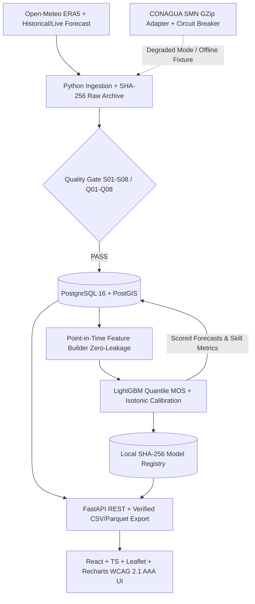
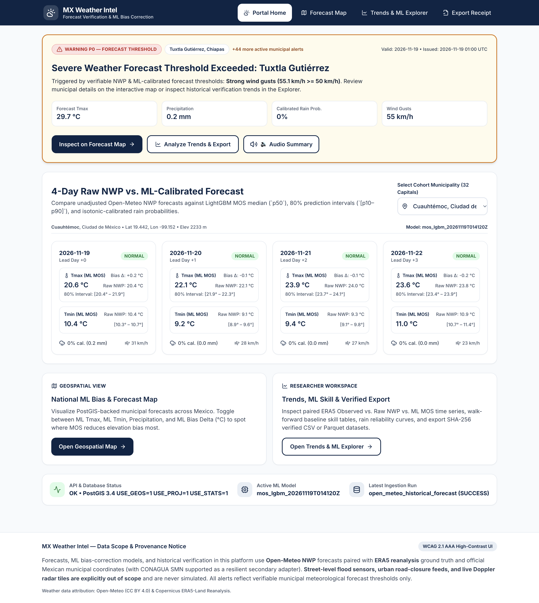
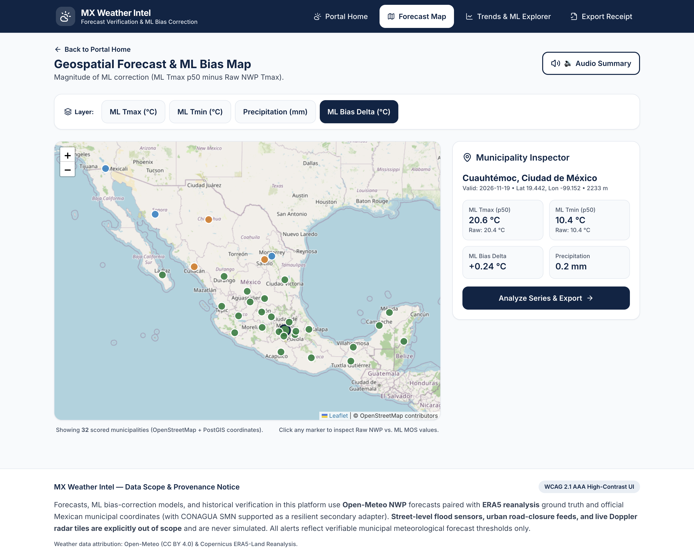
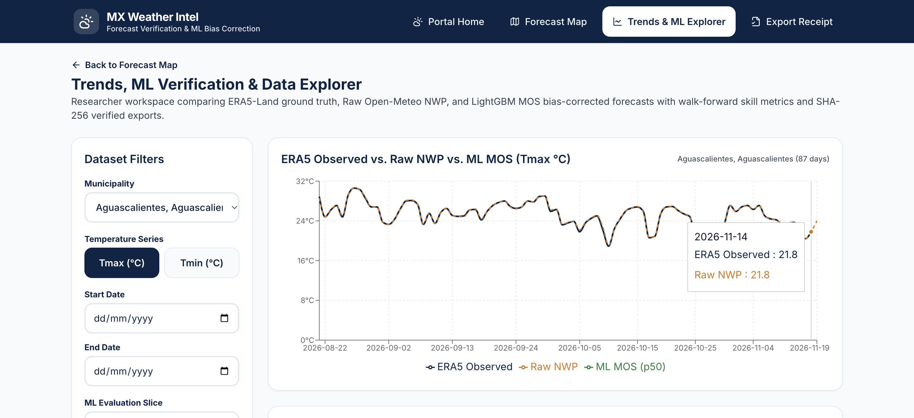
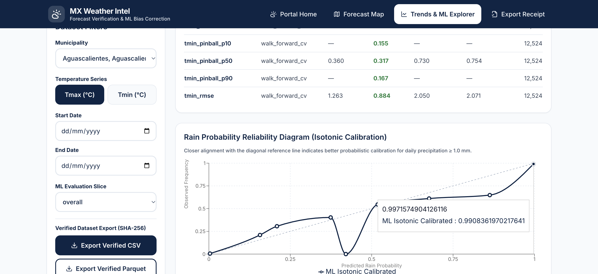

# MX Weather Intel — Forecast Verification & ML Bias-Correction Platform


A **100% local, Docker-reproducible operational weather data & ML post-processing platform** for Mexico — combining revision-aware forecast ingestion into **PostgreSQL 16 + PostGIS** (`32` states, `2,463` official municipalities), **Model Output Statistics (MOS)** temperature bias correction & precipitation probability calibration with **LightGBM + Isotonic Regression** (enforcing zero temporal leakage), a typed **FastAPI** serving/export layer, and a **WCAG 2.1 AAA responsive web portal** adapted from a Google UX Design System.

---

## Architecture



### Core Engineering Highlights

- **Dual-Source Resilient Ingestion ([ADR-0001](docs/architecture/decisions/ADR-0001-dual-source-resilience.md)):** Live checks showed CONAGUA's SMN endpoint returning `HTTP 500` / timeouts. `mx-weather-intel` uses Open-Meteo (ERA5-Land + Historical/Live Forecast, CC BY 4.0) as the reliable primary feed while maintaining a tested CONAGUA SMN GZip adapter with graceful `DEGRADED_UPSTREAM` circuit-breaker logging and offline verification against real SMN golden fixtures.
- **Revision-Aware Temporal & PostGIS Schema ([ADR-0002](docs/architecture/decisions/ADR-0002-revision-aware-postgis-schema.md)):** Primary key `(source_provider, state_id, municipality_id, issued_at, valid_date)` preserves forecast revision history, enforces `valid_date >= issued_at::date` in PostgreSQL `CHECK` constraints, and indexes municipal coordinates with PostGIS `GEOGRAPHY(POINT, 4326)` GiST for exact spherical radius search (`ST_DWithin`).
- **Zero-Leakage Point-in-Time ML Pipeline ([ADR-0003](docs/architecture/decisions/ADR-0003-mos-lightgbm-and-calibration.md)):** Strictly lagged rolling station bias features (`obs_date < valid_date - max(1, lead_day)`) verified by an automated **future-perturbation test** (`+999.0` mutation on future targets asserts bit-for-bit identical features).
- **WCAG 2.1 AAA GoogleUX Web Portal ([ADR-0005](docs/architecture/decisions/ADR-0005-googleux-scope-honesty.md)):** Deep Navy `#0B2545`, Amber P0 `#FFFBEB`/`#D97706` Gestalt *Common Region*, `48×48px` touch targets, semantic HTML landmarks, Web Speech API audio summary, interactive Leaflet map, researcher ML skill & reliability diagram, and SHA-256 verified `CSV`/`Parquet` export receipts.

---

## Verified Real-Data ML Holdout Benchmarks (`mos_lgbm_20261119T014120Z`)

Evaluated on strictly held-out temporal test data (**`n = 3,410` municipality-days** across **`31/32` Mexican state capitals** (`Q08 = 96.88% >= 95%` PASS) from `2024-11-14` to `2026-11-14`; see [`docs/verification/execution-log.md`](docs/verification/execution-log.md)):

| Metric | Raw NWP Forecast | Persistence (`t-1`) | 30d Climatology | **LightGBM MOS + Isotonic** | Delta vs. Raw NWP |
| :--- | :---: | :---: | :---: | :---: | :---: |
| **`tmax` MAE (°C)** | `0.422` | `1.575` | `1.733` | **`0.351`** | **`-16.8%`** |
| **`tmax` RMSE (°C)** | `0.913` | `2.176` | `2.401` | **`0.633`** | **`-30.7%`** |
| **`tmax` Bias (°C)** | `+0.300` | `+0.106` | `+0.570` | **`+0.012`** | Bias eliminated |
| **`tmax` 80% Coverage** | — | — | — | **`79.7%`** | Target `80.0%` |
| **`tmin` MAE (°C)** | `0.348` | `1.177` | `1.168` | **`0.343`** | **`-1.3%`** |
| **`tmin` RMSE (°C)** | `0.673` | `1.625` | `1.700` | **`0.570`** | **`-15.3%`** |
| **`tmin` 80% Coverage** | — | — | — | **`77.2%`** | Target `80.0%` |
| **Rain (`>=1mm`) Brier Score** | `0.1453` | `0.3616` | `0.2238` | **`0.0331`** | **`-77.2%`** |
| **Rain (`>=1mm`) ECE (10 bins)** | `0.0762` | `0.3616` | `0.0585` | **`0.0113`** | **`-85.2%`** |

### Measured Local API Latency (`concurrency = 1`, `n = 10`)

`GET /health`: `p50 = 1.50 ms` (`p95 = 2.09 ms`) · `GET /v1/forecasts/map`: `p50 = 7.34 ms` (`p95 = 8.47 ms`) · `GET /v1/ml/skill`: `p50 = 6.93 ms` (`p95 = 7.78 ms`) · `GET /v1/alerts`: `p50 = 29.75 ms` (`p95 = 55.02 ms`).

---

## UI & Verification Preview (WCAG 2.1 AAA GoogleUX System)

### Portal Home — Active Forecast Alerts & 4-Day Raw vs. ML-Calibrated Cards


### Geospatial Forecast Map — PostGIS 32-Capital ML Bias Delta Layer


### Researcher Explorer — ERA5 Observed vs. Raw NWP vs. ML MOS Trends


### ML Verification — Walk-Forward Skill Table & Isotonic Rain Reliability Diagram


---

## Quickstart (100% Local Docker Compose)

Requires **Docker** and **Docker Compose** (no local Python or Node installation needed to run the stack):

```bash
# 1. Start PostgreSQL + PostGIS, run Alembic migrations, and seed 32 states / 2,463 municipalities
docker compose up -d postgres
docker compose run --rm pipeline alembic upgrade head
docker compose run --rm pipeline python scripts/seed_catalog.py

# 2. Backfill historical paired data, ingest live 4-day forecasts, train & score LightGBM MOS
docker compose run --rm pipeline python scripts/run_backfill.py --months 24 --delay 1.5
docker compose run --rm pipeline python scripts/run_daily_ingest.py
docker compose run --rm pipeline python scripts/train_models.py
docker compose run --rm pipeline python scripts/score_forecasts.py

# 3. Launch FastAPI (http://127.0.0.1:8000/docs) and GoogleUX Web UI (http://127.0.0.1:5173)
docker compose up -d --build
```

### Run Automated Verification Suites

```bash
# Python unit, data-contract, zero-leakage, API contract, and Docker E2E tests
docker compose run --rm pipeline pytest tests/unit tests/api tests/integration/test_e2e_docker.py -q

# Frontend strict TypeScript build + WCAG/UI Vitest suite
cd web && npm ci && npm run build && npm test
```

---

## Documentation & Verification Index

| Document | Focus | Link |
| :--- | :--- | :--- |
| **Architecture & ADRs** | Container topology & ADRs `0001`–`0005` | [Architecture Overview](docs/architecture/overview.md) |
| **Data & Quality Contracts** | Declarative rules `S01`–`S08` & `Q01`–`Q08` | [Data Contracts](docs/reference/data-contracts.md) |
| **Acceptance Plan** | Gates `G0`–`G6` verification matrix | [Acceptance Plan](docs/verification/acceptance-plan.md) |
| **Empirical Execution Log** | Real API checks, ML metrics, test counts, and limitations | [Execution Log](docs/verification/execution-log.md) |

---

## Domain Scope & Limitations

- **Forecast-Threshold Alerts Only:** Operational `ADVISORY` and `WARNING_P0` alerts are computed strictly from verifiable municipal forecast thresholds (`precip_mm`, `tmax_c`, `tmin_c`, `wind_gust_kmh`, `calibrated_rain_prob`). Street-level urban flood sensors (C5), live Doppler radar tiles, and WhatsApp dispatch are explicitly out of scope.
- **Reanalysis Ground Truth:** Historical ground truth uses Open-Meteo ERA5-Land reanalysis (CC BY 4.0) paired with Open-Meteo Historical Forecasts rather than physical EMA ground stations.
- **License:** Source code is licensed under the [MIT License](LICENSE). Open-Meteo weather data is subject to [CC BY 4.0](https://creativecommons.org/licenses/by/4.0/) (non-commercial free tier).
