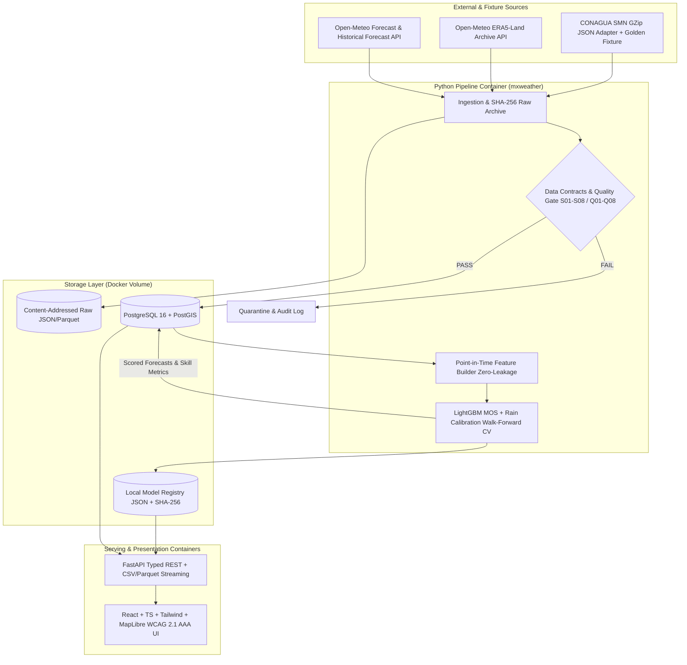
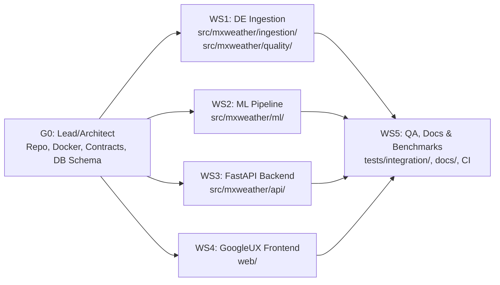

# Implementation Plan: Mexico Weather Forecast Verification & ML Bias-Correction Platform (`mx-weather-intel`)

## Goal Description

Build a **100% local, Docker-reproducible second flagship portfolio project** that closes the remaining gaps across both **Junior Data Engineering** and **Junior AI/ML Engineering** tracks while complementing [`hvfhv`](file:///Users/emilianodesu/Documents/Projects/hvfhv/README.md):

1. **Modern Data Engineering Backbone:** Replace the legacy academic Pentaho + non-versioned Postgres pipeline ([`Proyecto_Final`](file:///Users/emilianodesu/Documents/Projects/weather/Proyecto_Final)) with a clean, solo-authored, revision-aware operational weather platform using **Python 3.12**, **PostgreSQL 16 + PostGIS**, **Alembic**, content-addressed raw snapshots, and strict data-quality contracts (`S01`–`S08`, `Q01`–`Q08`).
2. **Rigorous AI/ML Engineering Layer (MOS Bias Correction & Calibration):** Train and evaluate **Model Output Statistics (MOS)** models (**LightGBM** point + quantile regressors for `tmax`/`tmin`, and **calibrated rain probability** classifier for precipitation $\ge 1.0\text{ mm}$) across a diverse cohort of **32 Mexican state capitals / elevation bands** using **24 months** of paired historical NWP forecasts and ERA5-Land ground truth, with **temporal walk-forward validation**, explicit baselines, and automated zero-leakage checks.
3. **Typed Serving API & GoogleUX WCAG 2.1 AAA Web UI:** Expose a **FastAPI** backend serving geospatial municipal forecasts, raw vs. ML-calibrated predictions, forecast-skill metrics, and verified `CSV`/`Parquet` exports to a responsive **React + TypeScript + Tailwind + MapLibre/Leaflet** frontend adapted directly from your [`GoogleUX`](file:///Users/emilianodesu/Documents/GoogleUX/6%20Build%20Dynamic%20User%20Interfaces%20(UI)%20for%20Websites/01_Entregables_Proyecto/Caso_de_Estudio_Completo_Sitio_Web_Responsivo_SMN.md) design system.

---

## Empirical Feasibility Findings (Verified 2026-11-18)

Before locking the architecture, live read-only HTTP checks were executed:

| Source / Endpoint | Observed Result (2026-11-18) | Architectural Decision |
| :--- | :--- | :--- |
| `https://smn.cna.gob.mx/webservices/?method=1` | **Timed out** (>15s) | Do **not** couple the pipeline exclusively to live CONAGUA uptime. |
| `https://smn.conagua.gob.mx/webservices/?method=1` | `301` → `/es/webservices?method=1` → **`HTTP 500`** (HTML error) | Implement `conagua_smn` as a **resilient secondary adapter** with circuit-breaker + offline replay verified against the real 3.38 MB [`dato_servicio_web.json`](file:///Users/emilianodesu/Documents/Projects/weather/Proyecto_Final/modelado_con_sql/dato_servicio_web.json) golden fixture. |
| `https://archive-api.open-meteo.com/v1/archive` (ERA5) | **`HTTP 200` (<1 ms)** — returns `elevation`, `temperature_2m_max`, `temperature_2m_min`, `precipitation_sum`, `wind_speed_10m_max`, `wind_gusts_10m_max` | **Primary ground-truth source** (CC BY 4.0, free non-commercial, no API key). |
| `https://historical-forecast-api.open-meteo.com/v1/forecast` | **`HTTP 200` (18 ms)** — returns matching forecast variables + `precipitation_probability_max` | **Primary historical & live forecast source** enabling immediate 24-month ML training & verification without waiting months for live accumulation. |
| Local Docker Environment | `Docker 29.9.1` + `Docker Compose v5.6.1` installed | Full multi-service local stack (`postgres`, `pipeline`, `api`, `web`) is immediately feasible. |

---

## User Review Required

> [!IMPORTANT]
> **Repository Location & Authorship Boundary (`GH-08` / `SYS-09`)**
> Because [`Proyecto_Final`](file:///Users/emilianodesu/Documents/Projects/weather/Proyecto_Final) was a 4-person UNAM academic project, the new repository will be created as a **clean, solo-authored repo** at `/Users/emilianodesu/Documents/Projects/mx-weather-intel` (keeping `Projects/weather/Proyecto_Final` untouched as historical reference). We will copy only the sanitized municipal catalog / golden fixture (`dato_servicio_web.json` excerpt) with explicit provenance notes. Confirm if `/Users/emilianodesu/Documents/Projects/mx-weather-intel` is your preferred path.

> [!WARNING]
> **GoogleUX Honesty Boundary (No Fabricated Sensors)**
> The Figma prototype includes street-level C5 flood closures, live Doppler radar tiles, and WhatsApp dispatch. Because no free public API supplies those feeds, the web UI will adapt the **exact WCAG 2.1 AAA design system, layout, personas, and audio summary** while grounding alerts strictly in real municipal forecast thresholds (`prec`, `probprec`, `tmax`, `tmin`, `raf`) and clearly labeling the scope boundary (matching `hvfhv`'s semantic honesty standard).

> [!NOTE]
> **ML Backfill Cohort Scope (Rate-Limit Safe)**
> To keep the local Docker setup fast and respectful of Open-Meteo's free tier, the default ML training cohort covers **32 Mexican state capitals** (1 per state, spanning coastal, arid, highland, and tropical elevations from 5m to 2,660m) over **24 months** (~23,360 municipality-day pairs). The municipal catalog table still holds all **~2,475 official Mexican municipalities** for live forecast lookup and geospatial exploration.

---

## System Architecture

---

## Teamwork Execution Plan (5 Parallel Workstreams + 7 Gates)

This plan is structured specifically for **`/teamwork` mode** with disjoint file ownership per agent so streams can run in parallel without merge conflicts once **Gate G0 (Scaffold & Contracts)** completes.

### Workstream Ownership & File Boundaries

| Agent Role | Owned Paths | Primary Deliverable | Depends On |
| :--- | :--- | :--- | :--- |
| **WS0 — Architect / Foundation** | `docker-compose.yml`, `pyproject.toml`, `Makefile`, `contracts/`, `alembic/`, `src/mxweather/db/`, `src/mxweather/config.py`, `fixtures/` | Bootable Docker stack (Postgres 16 + PostGIS), Alembic schema, canonical contracts & municipal catalog seed | None (runs first) |
| **WS1 — Data Engineering (Ingestion & Quality)** | `src/mxweather/ingestion/`, `src/mxweather/quality/`, `scripts/run_backfill.py`, `scripts/run_daily_ingest.py`, `tests/unit/test_ingestion*.py`, `tests/unit/test_quality*.py` | Open-Meteo + resilient CONAGUA SMN adapters, SHA-256 raw archive, idempotent Postgres upserts, `S01`–`S08` & `Q01`–`Q08` gates | WS0 schema & contracts |
| **WS2 — AI/ML Engineering (MOS & Calibration)** | `src/mxweather/ml/`, `scripts/train_models.py`, `scripts/score_forecasts.py`, `tests/unit/test_ml*.py` | Point-in-time feature builder, zero-leakage tests, baselines, LightGBM point/quantile regressors + calibrated rain model, walk-forward evaluation report & local model registry | WS0 schema (can develop against synthetic/fixture data in parallel with WS1, then run on real backfill) |
| **WS3 — Backend API (FastAPI)** | `src/mxweather/api/`, `tests/api/` | Typed REST endpoints (`/health`, `/v1/municipalities`, `/v1/forecasts`, `/v1/alerts`, `/v1/ml/skill`, `/v1/export` CSV/Parquet with SHA-256), OpenAPI schema, latency/contract tests | WS0 schema + shared Pydantic DTOs |
| **WS4 — Frontend (GoogleUX WCAG AAA)** | `web/` (Vite + React + TS + Tailwind + MapLibre/Leaflet + Recharts + Vitest/Playwright smoke) | 4 responsive screens adapted from GoogleUX Figma (Desktop 1440px & Mobile 390px), WCAG AAA palette, Web Speech audio summary, map, researcher explorer & export receipt | WS3 OpenAPI contract (can mock during build, then bind live) |
| **WS5 — Verification, Docs & Benchmarks** | `tests/integration/`, `.github/workflows/ci.yml`, `docs/` (`arc42`, ADRs `0001`–`0005`, `acceptance-plan.md`, `execution-log.md`), `README.md` | End-to-end Docker integration suite, real-data empirical execution log, ML skill benchmark tables, UI screenshots, CI workflow | WS1–WS4 |

---

## Proposed Changes (Component-by-Component Specification)

### Component 1 — Foundation, Docker Compose & PostgreSQL/PostGIS Schema (`WS0`)

#### [NEW] `docker-compose.yml`
4-service local stack with healthchecks and zero hardcoded secrets (configured via `.env.example`):
- `postgres`: `postgis/postgis:16-3.4-alpine`, persistent volume `pg_data`, healthcheck via `pg_isready`.
- `pipeline`: Python 3.12 image running Alembic migrations, backfill/daily ingestion, and ML training/scoring CLI commands (profile-triggered or on-demand via `docker compose run --rm pipeline ...`).
- `api`: FastAPI + Uvicorn (`127.0.0.1:8000`), depends on healthy `postgres`, mounts read-only `artifacts/models`.
- `web`: Vite/Nginx (`127.0.0.1:5173`), proxies `/api/*` to `api:8000`.

#### [NEW] `alembic/versions/0001_initial_schema.py` & `src/mxweather/db/models.py`
Normalized, revision-aware relational + geospatial schema:
- `dim_state (state_id SMALLINT PK, state_name TEXT NOT NULL)`
- `dim_municipality (state_id SMALLINT, municipality_id SMALLINT, municipality_name TEXT, lat NUMERIC(9,6), lon NUMERIC(9,6), elevation_m NUMERIC(7,2), utc_offset_hours SMALLINT, is_ml_cohort BOOLEAN, geom GEOGRAPHY(POINT, 4326), PK(state_id, municipality_id))` + **GiST spatial index** on `geom`.
- `raw_ingestion_run (run_id UUID PK, source_provider TEXT, started_at TIMESTAMPTZ, completed_at TIMESTAMPTZ, status TEXT, payload_sha256 TEXT, records_read INT, records_loaded INT, records_quarantined INT, error_detail TEXT)`
- `fact_forecast_revision (source_provider TEXT, state_id SMALLINT, municipality_id SMALLINT, issued_at TIMESTAMPTZ, valid_date DATE, lead_day SMALLINT, tmax_c NUMERIC(5,2), tmin_c NUMERIC(5,2), precip_mm NUMERIC(7,2), precip_prob_pct SMALLINT, wind_speed_kmh NUMERIC(6,2), wind_gust_kmh NUMERIC(6,2), cloud_cover_pct NUMERIC(5,2), sky_desc TEXT, run_id UUID FK, PK(source_provider, state_id, municipality_id, issued_at, valid_date))`
  - Check constraints: `tmax_c >= tmin_c`, `precip_mm >= 0`, `precip_prob_pct BETWEEN 0 AND 100`, `lead_day >= 0`, `valid_date >= (issued_at AT TIME ZONE 'UTC')::date`.
  - Composite index on `(state_id, municipality_id, valid_date DESC, issued_at DESC)`.
- `fact_observed_daily (source_provider TEXT, state_id SMALLINT, municipality_id SMALLINT, obs_date DATE, tmax_c NUMERIC(5,2), tmin_c NUMERIC(5,2), precip_mm NUMERIC(7,2), wind_speed_kmh NUMERIC(6,2), wind_gust_kmh NUMERIC(6,2), run_id UUID FK, PK(source_provider, state_id, municipality_id, obs_date))`
- `fact_ml_forecast (model_version TEXT, state_id SMALLINT, municipality_id SMALLINT, issued_at TIMESTAMPTZ, valid_date DATE, lead_day SMALLINT, raw_tmax_c NUMERIC(5,2), pred_tmax_p10 NUMERIC(5,2), pred_tmax_p50 NUMERIC(5,2), pred_tmax_p90 NUMERIC(5,2), raw_tmin_c NUMERIC(5,2), pred_tmin_p10 NUMERIC(5,2), pred_tmin_p50 NUMERIC(5,2), pred_tmin_p90 NUMERIC(5,2), raw_precip_prob_pct SMALLINT, calibrated_rain_prob NUMERIC(5,4), alert_level TEXT, PK(model_version, state_id, municipality_id, issued_at, valid_date))`
- `ml_model_evaluation (model_version TEXT, split_name TEXT, segment_key TEXT, metric_name TEXT, raw_baseline_val DOUBLE PRECISION, ml_model_val DOUBLE PRECISION, persistence_val DOUBLE PRECISION, climatology_val DOUBLE PRECISION, sample_count INT, evaluated_at TIMESTAMPTZ)`

#### [NEW] `contracts/data_contracts.json`
Machine-readable rule registry modeled after `hvfhv`:
- **Structural (`S01`–`S08`):** JSON/GZip integrity, required fields, municipality FK existence, valid coordinate bounds for Mexico (`14.0 <= lat <= 33.0`, `-119.0 <= lon <= -86.0`), non-null timestamps, schema version match.
- **Quality & Semantic (`Q01`–`Q08`):** `tmax_c >= tmin_c`, physical temperature bounds (`-25°C` to `55°C`), `precip_mm >= 0`, `precip_prob_pct` in `[0, 100]`, `wind_gust_kmh >= wind_speed_kmh` (warning/flag if violated), idempotent replay zero-duplicate invariant, **zero temporal leakage invariant (`issued_at::date <= valid_date`)**, cohort completeness (`>= 95%` of 32 capitals).

---

### Component 2 — Ingestion & Data Quality Gate (`WS1`)

#### [NEW] `src/mxweather/ingestion/open_meteo.py`
- Uses `httpx` with strict TLS, bounded exponential backoff, polite rate limiting, and local disk caching by SHA-256.
- Fetches:
  1. **ERA5 Archive** (`archive-api.open-meteo.com/v1/archive`) for 24 months of daily ground truth across the 32-capital cohort.
  2. **Historical Forecast** (`historical-forecast-api.open-meteo.com/v1/forecast`) for paired historical NWP forecasts over the exact same dates & coordinates.
  3. **Live Forecast** (`api.open-meteo.com/v1/forecast`) for operational 4-day forecasts (`lead_day = 0..3`) with `issued_at = current_utc_hour`.

#### [NEW] `src/mxweather/ingestion/conagua_smn.py`
- Parses GZip-compressed CONAGUA SMN JSON payloads (`ides`, `idmun`, `dloc`, `ndia`, `tmax`, `tmin`, `prec`, `probprec`, `cc`, `velvien`, `raf`, `dirvienc`, `dirvieng`, `desciel`), preserving `raf` and integer `ndia` (`0..3`).
- Implements an explicit **circuit breaker / degraded-mode handler**: when the live government endpoint times out or returns `HTTP 5xx` (as observed on 2026-11-18), it logs a structured `DEGRADED_UPSTREAM` run record in `raw_ingestion_run` without crashing the pipeline, while remaining 100% testable offline via `fixtures/smn_golden_sample.json`.

#### [NEW] `src/mxweather/quality/gate.py`
- Evaluates `S01`–`S08` and `Q01`–`Q08` on candidate batches before committing to PostgreSQL.
- Quarantines invalid rows with rule IDs rather than silently coercing or dropping data.

---

### Component 3 — AI/ML Pipeline: MOS Bias Correction & Rain Calibration (`WS2`)

#### [NEW] `src/mxweather/ml/features.py`
- Pure **Point-in-Time (PIT)** feature builder joining `fact_forecast_revision` with strictly past `fact_observed_daily` (`obs_date < issued_at::date`):
  - Raw forecast variables (`tmax_c`, `tmin_c`, `precip_mm`, `precip_prob_pct`, `wind_speed_kmh`, `wind_gust_kmh`, `lead_day`).
  - Static geospatial features (`lat`, `lon`, `elevation_m`, diurnal range `tmax_c - tmin_c`).
  - Cyclical calendar features (`sin/cos` of day-of-year).
  - Strictly lagged station error features: rolling 7-day and 30-day mean bias `(raw_tmax - obs_tmax)` and `(raw_tmin - obs_tmin)` computed **only from `obs_date <= valid_date - max(1, lead_day) - 1`** (enforced by automated leakage unit test that perturbs future targets and asserts features are bit-for-bit identical!).

#### [NEW] `src/mxweather/ml/train.py` & `src/mxweather/ml/evaluate.py`
- **Temporal Walk-Forward CV:** 4 expanding temporal folds (e.g., train months `1..12` → val `13..15`, ..., final holdout test on the last 3 months — **zero random shuffling**).
- **Explicit Baselines:**
  1. `raw_nwp`: unadjusted forecast from Open-Meteo NWP.
  2. `persistence`: yesterday's observed value (`obs_{t-1}`).
  3. `climatology_30d`: trailing 30-day municipal mean.
- **Models:**
  - `tmax` & `tmin`: **LightGBM** `regression_l1` (median/p50) + quantile `alpha=0.10` and `alpha=0.90` (80% prediction interval) with monotonicity check (`p10 <= p50 <= p90`).
  - Rain occurrence (`obs_precip_mm >= 1.0`): **LightGBM** binary classifier + **Isotonic Calibration** (`CalibratedClassifierCV` on temporal calibration split) compared against raw `precip_prob_pct / 100.0`.
- **Metrics Logged to `ml_model_evaluation` & `artifacts/models/<version>/metrics.json`:**
  - Temperature: `MAE`, `RMSE`, `Bias`, `Pinball Loss`, `80% Interval Coverage`.
  - Rain: `Brier Score`, `Log Loss`, `Expected Calibration Error (ECE)` (10 bins), plus reliability diagram bin data for the UI.
  - Sliced by **elevation band** (`Coastal < 500m`, `Midland 500–1800m`, `Highland > 1800m`) and **season** (`Dry` vs `Rainy`).
- **Deterministic Local Registry:** Saves `model_bundle.joblib`, `feature_schema.json`, `metrics.json`, and `manifest.sha256` under `artifacts/models/<version>/`.

---

### Component 4 — Typed Serving API (`WS3`)

#### [NEW] `src/mxweather/api/main.py` & `src/mxweather/api/routes/`
- `GET /health` — verifies Postgres + PostGIS connectivity, active model version, and latest ingestion run status.
- `GET /v1/municipalities?state_id=&search=&near_lat=&near_lon=&radius_km=` — PostGIS `ST_DWithin` / `ST_Distance` geospatial search + cohort flag.
- `GET /v1/forecasts/{state_id}/{municipality_id}` — returns 4-day forecast comparing **Raw NWP** vs. **ML-Calibrated (`p10`/`p50`/`p90` + calibrated rain probability)** + active alert tier (`NORMAL`, `ADVISORY`, `WARNING_P0`).
- `GET /v1/alerts` — returns municipalities currently crossing verifiable meteorological thresholds (e.g., `precip_mm >= 25`, `tmax_c >= 38`, `tmin_c <= 2`, `wind_gust_kmh >= 50`), explicitly labeled as forecast-threshold alerts.
- `GET /v1/trends/{state_id}/{municipality_id}?start_date=&end_date=` — paired historical observed vs. raw forecast vs. ML-corrected series for the researcher chart.
- `GET /v1/ml/skill` — returns model vs. baseline evaluation table (overall, by elevation band, by season) + calibration curve bins.
- `GET /v1/export?state_id=&municipality_id=&start_date=&end_date=&format=csv|parquet` — streams verified dataset with `X-Content-SHA256`, `X-Row-Count`, and provenance headers.

---

### Component 5 — GoogleUX WCAG 2.1 AAA Responsive Web UI (`WS4`)

#### [NEW] `web/` (React 19 + TypeScript + Vite + Tailwind CSS + MapLibre GL / Leaflet + Recharts)
Adapts your [`GoogleUX`](file:///Users/emilianodesu/Documents/GoogleUX/5%20Create%20High-Fidelity%20Designs%20and%20Prototypes%20in%20Figma/01_Entregables_Proyecto/Refinamiento_de_Mockups_Principios_Visuales.md) Design System tokens directly into `tailwind.config.ts`:
- **Color Tokens (WCAG 2.1 AAA > 7:1):** Navy `#0B2545`, Amber Surface `#FFFBEB` / Border `#D97706`, Danger `#FEE2E2` / `#B91C1C`, Safe `#DCFCE7` / `#15803D`, Surface `#FFFFFF` / Border `#E2E8F0`.
- **Typography & Accessibility:** `Inter` scale (`24px` Bold headlines, `18px` SemiBold metrics, `15px` Regular guidance, `12px` timestamps), minimum `48×48px` touch targets, semantic `<header>`, `<nav>`, `<main>`, `<aside>`, `<footer>`, and Web Speech API (`🔊 Escuchar Resumen` / `Audio Summary`) button.
- **4 Core Views (Desktop `1440px` + Mobile `390px`):**
  1. **Portal Home (`/`)**: Active P0/Advisory forecast-threshold card (Gestalt *Common Region*), municipality selector, 4-day Raw vs. ML-Calibrated forecast cards (with 80% uncertainty range), and live ingestion/model status strip.
  2. **Geospatial Forecast Map (`/map`)**: Interactive map of Mexico colored by `tmax`, `tmin`, `precip_mm`, or `ML Bias Delta (°C)` with clickable municipality popups (PostGIS-backed).
  3. **Trends, ML Verification & Data Explorer (`/explorer`)**: Researcher workspace (Dr. Arismendi persona) with `<aside>` filter panel (sticky drawer on `390px` mobile), Raw vs. ML vs. ERA5 Observed chart, Reliability/Calibration curve & Baseline Skill table, and one-click `CSV` / `Parquet` export.
  4. **Verified Export Receipt (`/export-receipt`)**: Displays downloaded filename, row count, `SHA-256` checksum, data provenance/limitations notice, and return-to-home CTA.

---

### Component 6 — Verification Matrix, CI & Flagship Documentation (`WS5`)

Matches `hvfhv`'s `docs/` standard:
- `docs/architecture/overview.md` + `docs/architecture/decisions/ADR-0001..0005.md` (Dual-source resilience, Revision-aware schema, MOS LightGBM + Isotonic calibration, Local model registry, GoogleUX scope honesty).
- `docs/reference/data-contracts.md` (`S01`–`S08`, `Q01`–`Q08`).
- `docs/verification/acceptance-plan.md` & `docs/verification/execution-log.md` (exact commands, SHA-256 digests, real ML metrics vs. baselines, API latency percentiles, test counts).
- `.github/workflows/ci.yml` (runs Python unit/contract/leakage tests + frontend build/unit tests on every push).

---

## Verification Plan (Gates `G0`–`G6`)

### Automated Tests
| Gate | Scope | Exact Verification Command | Acceptance Criterion |
| :--- | :--- | :--- | :--- |
| **G0 — Environment & Schema** | Docker Compose, Postgres + PostGIS, Alembic migrations | `docker compose up -d postgres && docker compose run --rm pipeline alembic upgrade head` | Clean schema creation, PostGIS extension active, GiST + composite indexes verified |
| **G1 — Ingestion & Contracts** | Offline SMN golden fixture + live Open-Meteo + idempotent replay | `pytest tests/unit/test_ingestion*.py tests/unit/test_quality*.py -q` | 100% pass; re-running identical batch yields `0` duplicates; SMN HTTP 500 degrades gracefully |
| **G2 — Zero-Leakage & ML Unit** | Point-in-time feature builder, future-perturbation test, baselines, quantile monotonicity | `pytest tests/unit/test_ml*.py -q` | Future target perturbation produces `0.0` feature diff; `p10 <= p50 <= p90` on 100% of predictions |
| **G3 — Real-Data Backfill & ML Evaluation** | 32 Mexican capitals × 24 months real Open-Meteo backfill + walk-forward training | `docker compose run --rm pipeline python scripts/run_backfill.py && docker compose run --rm pipeline python scripts/train_models.py` | Complete metrics JSON + SHA-256 model bundle; honest comparison vs. raw NWP, persistence, and climatology (even if a slice does not beat raw NWP, reported honestly) |
| **G4 — FastAPI Contract & Export** | All `/v1/*` endpoints, PostGIS radius query, CSV/Parquet SHA-256 export | `pytest tests/api/ -q` | 100% pass; exported CSV/Parquet matches DB row count and `X-Content-SHA256` header |
| **G5 — Frontend Build & Accessibility** | TypeScript strict build, component tests, WCAG contrast tokens | `cd web && npm ci && npm run build && npm test` | Zero TS/build errors; all component tests pass |
| **G6 — Full Docker E2E Smoke** | Full `docker compose up --build` stack + health + end-to-end API/UI smoke | `docker compose up -d --build && pytest tests/integration/ -q` | All 4 containers healthy; live API & UI serve real scored forecasts and verified exports |

### Manual Verification (User Visual & Domain Check)
1. Run `docker compose up --build` on a clean checkout and open `http://127.0.0.1:5173`.
2. Verify **Desktop (`1440px`)** and **Mobile (`390px`)** responsive layouts against your GoogleUX Figma tokens (Amber P0 alert card, 48px touch targets, `🔊 Audio Summary` readout).
3. In `/explorer`, inspect **Raw NWP vs. ML-Calibrated vs. ERA5 Observed** for at least 2 contrasting cities (e.g., CDMX highland vs. Mérida coastal), download a `CSV` and `Parquet` export, and confirm the receipt's SHA-256 matches `shasum -a 256` locally.
4. Review `docs/verification/execution-log.md` and `README.md` before any public GitHub push.
